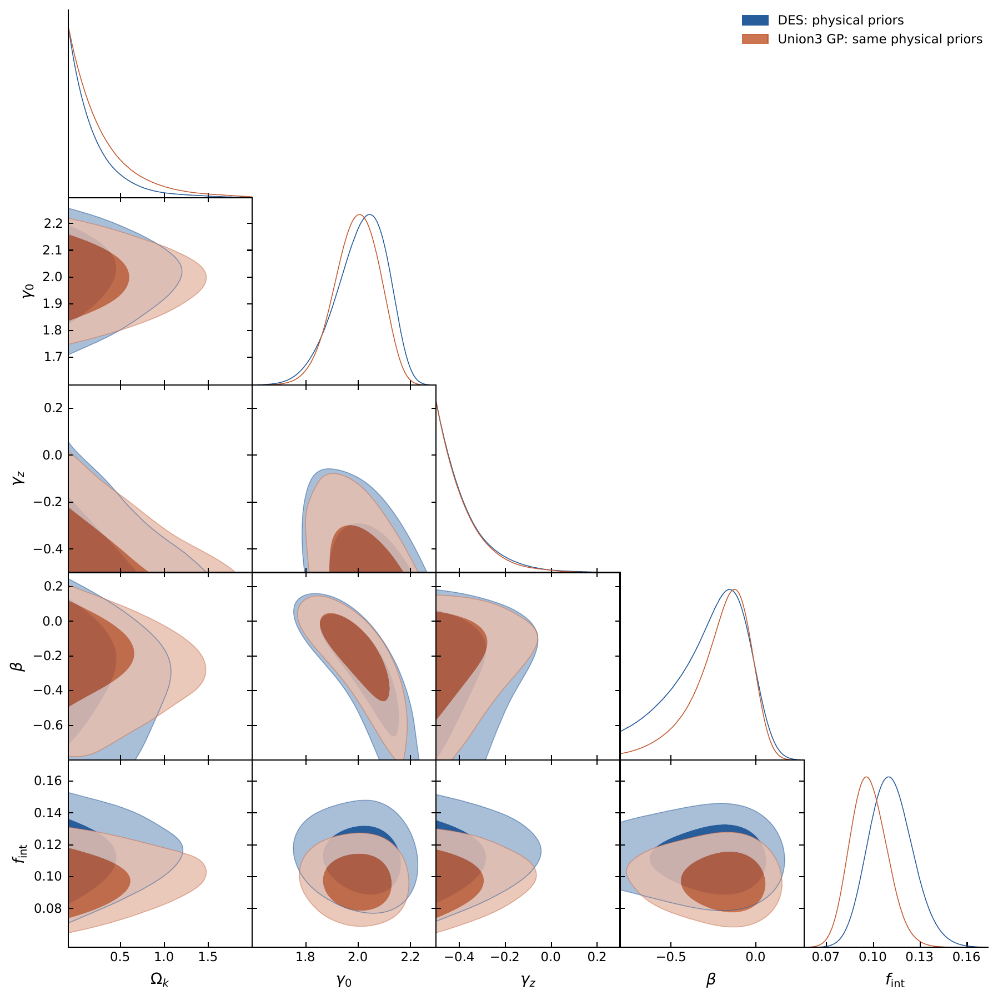

# SGL-Curvature-MCMC

Public software version: **1.0.1**. The manuscript revision label **v10** is an internal document version and is separate from the software release number.

Code, observational inputs, saved numerical summaries, and **all six figures** for the prepared v10 revision of *Joint Inference of Cosmic Curvature and Lens Density-Slope Evolution with Full Supernova Covariance and a CMB Geometric Constraint*.

Authors: Jian Hu, Yi Liu, Chen Wang, Jian-Ping Hu, Jia Zhao, and Liangqing Zhu.

[中文说明](README_zh.md) · [All figures](figures/README.md) · [Code/result map](docs/RESULT_MAP.md)

## Main posterior triangle — Figure 2

The main triangle is included as the original [vector PDF](figures/fig_triangle.pdf) and a [PNG preview](figures/fig_triangle.png). Its PDF is byte-identical to Figure 2 in the prepared v10 manuscript.



## Contents

| Location | Contents |
|---|---|
| `figures/` | All six manuscript figures, original PDFs and PNG previews |
| `codeanddata/` | 130-lens catalog, 1820-row DES-Dovekie Hubble diagram, packed full precision matrix, Union3 nodes/covariance, and legacy comparison inputs |
| `addcode/` | CosmoMatcher v1.4.3 assignment engine and plotting utilities |
| `reproduction/` | Likelihoods, physical priors, nonlinear sampler, and frozen matching outputs |
| `reproduction_physical/` | Primary and comparison fit summaries |
| `reproduction_supplement/` | Sensitivity, simulation, target-redshift, residual, and curvature-leverage code and saved diagnostics |
| `provenance/` | Input/figure inventories, checksums, and registry of the 28 saved analyses |
| `tests/` | Numerical checks of dynamics, distance derivatives, normalization, and CMB geometry |

## Included inputs; omitted chains

**No MCMC parameter chains or latent-distance chain arrays are included.** Figure PDFs, PNG previews, summary JSON files, diagnostic tables, and analysis code are included. Viewing the figures requires no sampling or chain download.

The derived dense DES covariance `reproduction/des_covariance.npy` is also omitted: it is a reproducible data cache, not an MCMC chain. Reconstruct it from the included `codeanddata/covtot_inv_000.npz` with the preparation command below. The full precision matrix is inverted **before** selecting the 176 SN rows.

This is a prepared upload package. It does not assert that a GitHub release or Zenodo version DOI has already been published. Manuscript source and PDF are not included in this code/data upload.

## Verify without chains

Use a Python environment with the dependencies in `requirements.txt` / `environment.yml`. The pinned file records the reference environment; see `docs/REPRODUCING.md` for numerical portability.

```bash
python reproduce.py prepare
python reproduce.py verify
python -m unittest discover -s tests -v
python reproduce.py matching
```

These reconstruct the full covariance, verify file hashes and saved summaries, evaluate reference likelihoods, run numerical checks, and rerun the primary two-stage matching. They do **not** resample the posterior or verify posterior quantiles from chains.

## Sampling and chain-dependent postprocessing

Full production sampling code is retained:

```bash
python reproduce.py sample --cases base,soft07,lens_noise,beta_prior,delta_plus,delta_minus,gzwide
python reproduce.py sample --kind linear --cases base,diagonal,nomismatch,transfer,union_same,union_all --steps 12000
python reproduce.py sensitivity
python reproduce.py simulate
```

Sampling writes to new workspaces under `outputs/`. The primary model fixes H0=70 and applies the external CMB condition and reference evolution prior; the lower-level `inference.Model` alone does not define that primary external condition.

`verify --chains`, `figures`, `diagnostics`, `exact-redshift`, and recomputing posterior correlations with `curvature_leverage.py` require saved chains (including baseline latent states for some commands). Their code and reference outputs are included, but those arrays are not. The restore command accepts a separately obtained historical `saved_chains_apj_v6_20261025.zip`; no public download for that archive is claimed here. See [the reproduction guide](docs/REPRODUCING.md).

## Interpretation

The curvature interval is conditional on the CMB geometric bound and lens-population prior. The lens kinematic curvature response is weak, and the source-redshift residual trend persists under the tested distance prescriptions. Six fixed-design simulations are model diagnostics, not a frequentist coverage calibration. DES and Union3 share lenses and are not independent constraints.

## All manuscript figures

| Figure | Description | Original PDF | Preview |
|---|---|---|---|
| 1 | Curvature and slope-evolution posterior CDFs | [PDF](figures/fig_physical_posteriors.pdf) | [PNG](figures/fig_physical_posteriors.png) |
| 2 | Main posterior triangle: DES and Union3 comparison | [PDF](figures/fig_triangle.pdf) | [PNG](figures/fig_triangle.png) |
| 3 | Source-redshift residual trend | [PDF](figures/fig_source_trend.pdf) | [PNG](figures/fig_source_trend.png) |
| 4 | Alternative distance prescriptions | [PDF](figures/fig_exact_redshift.pdf) | [PNG](figures/fig_exact_redshift.png) |
| 5 | Assignment and sample comparison | [PDF](figures/fig_matching.pdf) | [PNG](figures/fig_matching.png) |
| 6 | Six fixed-design simulations | [PDF](figures/fig_mock_recovery.pdf) | [PNG](figures/fig_mock_recovery.png) |

## License and attribution

Original project software uses the MIT License. Survey data and AAS style files retain their upstream terms; see [LICENSE_SCOPE.md](LICENSE_SCOPE.md) and [data sources](codeanddata/DATA_SOURCES.md). Creator metadata is in `CITATION.cff` and `addcode/CosmoMatcher_CITATION.cff`. Those prepared metadata do not imply publication or archival DOI completion.

Duplicate derived covariance text exports are omitted; all raw inputs, matching maps, summaries and generating code are retained.
