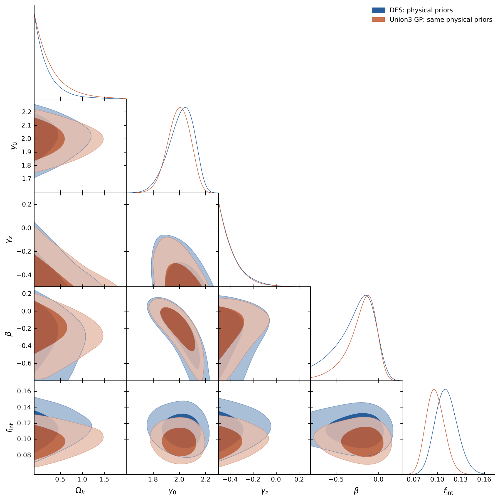

# SGL-Curvature-MCMC：GitHub 上传版

公开软件版本为 **1.0.1**；论文内部修订编号仍为 **v10**，二者分别管理。

本文件夹对应 v10 修改稿，包含分析代码、输入数据、28 组结果摘要、诊断表格、全部六张论文图片。MCMC 参数链和潜在距离链不包含在内。

**主要三角图：** [PDF](figures/fig_triangle.pdf) / [PNG](figures/fig_triangle.png)。首页直接显示 PNG，`figures/` 集中存放全部六张图片。



## 文件位置

- [全部六张图片](figures/README.md)：每张有原始矢量 PDF 和 PNG 预览；两处 PDF 逐字节相同。
- `codeanddata/`：130 透镜星表、DES-Dovekie 1820 行数据、完整精度矩阵压缩输入、Union3 节点与协方差，以及初稿配对对照输入。
- `addcode/`、`reproduction/`、`reproduction_supplement/`：配对、似然、非线性采样、敏感性、模拟、距离重建、残差与绘图代码。
- `reproduction_physical/` 和补充目录：保存的摘要和诊断结果。
- `provenance/result_registry.csv`：28 组分析对应关系；`repository_manifest.json` 为当前文件清单。

## 无需链即可执行的检查

在具有 `requirements.txt` 所列科学计算依赖的 Python 环境中运行：

```bash
python reproduce.py prepare
python reproduce.py verify
python -m unittest discover -s tests -v
python reproduce.py matching
```

完整 DES 协方差缓存 `reproduction/des_covariance.npy` 未放入上传目录，由附带的 `codeanddata/covtot_inv_000.npz` 重建。必须先反演完整精度矩阵，再提取样本子块。该缓存不是 MCMC 链。

这些检查核对输入、模型、摘要和配对，不等于从链重新核验后验分位数。查看现成图片不需要链。

## 重新采样和重绘

`sample`、`sensitivity`、`simulate` 等生产采样代码均保留，默认写入新的 `outputs/`，不覆盖冻结结果。

`verify --chains`、`figures`、`diagnostics`、`exact-redshift` 以及 `curvature_leverage.py` 的后验相关系数计算需要额外保存链；部分流程还需主分析潜在距离状态。本次不附这些数组，也不声称它们已公开下载。已有图和数字摘要均可直接查看。

详见 [英文说明](README.md)、[复现指南](docs/REPRODUCING.md) 和 [结果对应表](docs/RESULT_MAP.md)。主分析通过 `PhysicalModel` 加入 CMB 外部条件，不能把底层 `inference.Model` 的旧无 CMB 路线当主结果。

## 科学与发布状态

曲率区间以固定距离归一化、CMB 几何条件和人口先验为条件。当前样本曲率响应较弱，源红移残差趋势仍在；六组固定设计模拟不构成覆盖率校准。DES 与 Union3 共用透镜，并非独立约束。

这是本地准备好的上传文件夹，本次没有推送 GitHub 或生成 Zenodo DOI。本包不包含论文 PDF、LaTeX 工程或投稿材料。项目代码使用 MIT，数据及 AAS 文件沿用原权利条款，见 `LICENSE_SCOPE.md`。

重复导出的派生协方差文本已移出；原始输入、配对表、结果摘要和生成代码均保留。
