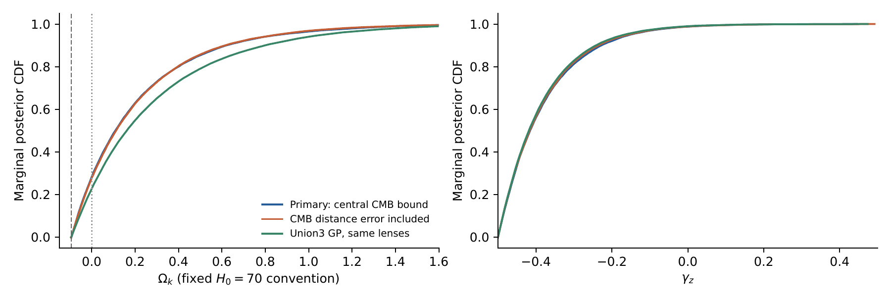
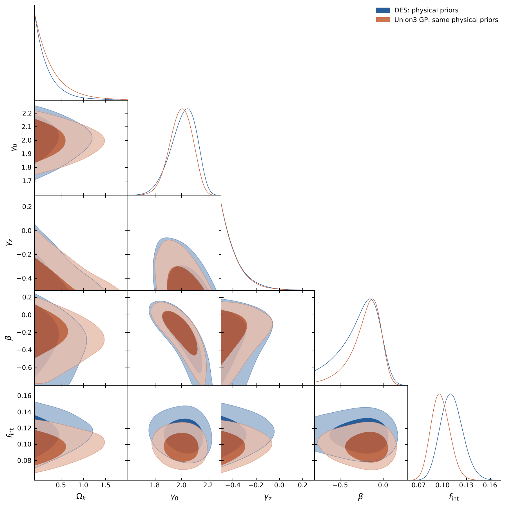
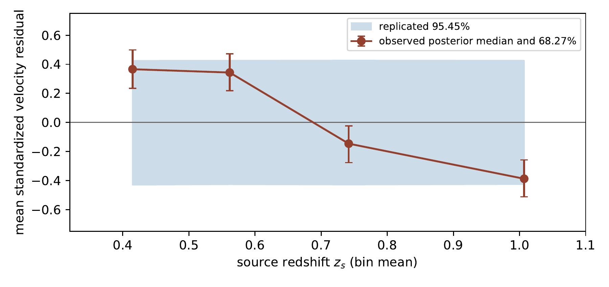
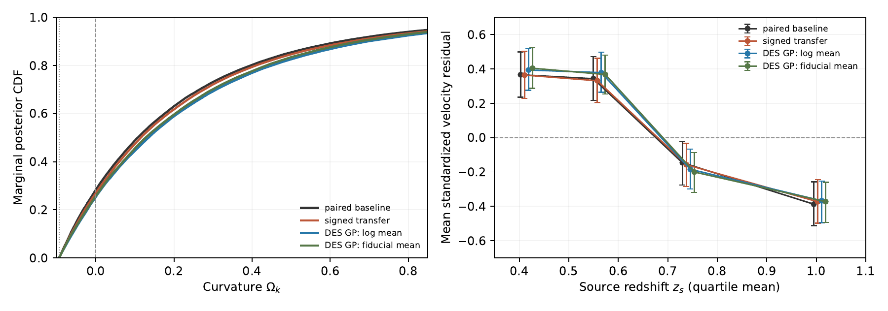
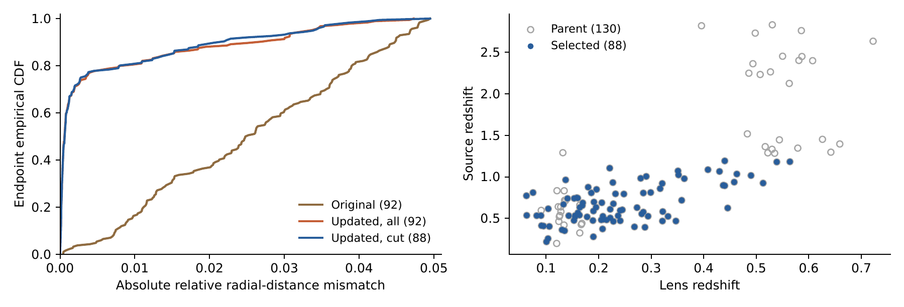
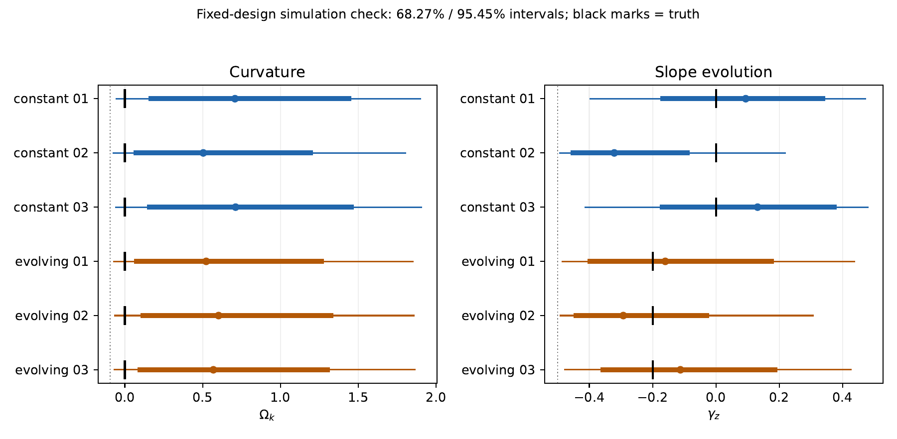

# All six manuscript figures

Original PDFs are byte-identical to the six figures in the prepared v10 manuscript. PNGs are previews rendered from those PDFs. No MCMC chains are needed to view them.

## Figure 1: Curvature and slope-evolution posterior CDFs

[Vector PDF](fig_physical_posteriors.pdf)

## Figure 2: Main posterior triangle: DES and Union3 comparison

[Vector PDF](fig_triangle.pdf)

## Figure 3: Source-redshift residual trend

[Vector PDF](fig_source_trend.pdf)

## Figure 4: Alternative distance prescriptions

[Vector PDF](fig_exact_redshift.pdf)

## Figure 5: Assignment and sample comparison

[Vector PDF](fig_matching.pdf)

## Figure 6: Six fixed-design simulations

[Vector PDF](fig_mock_recovery.pdf)

